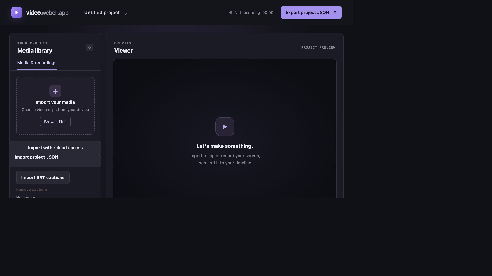
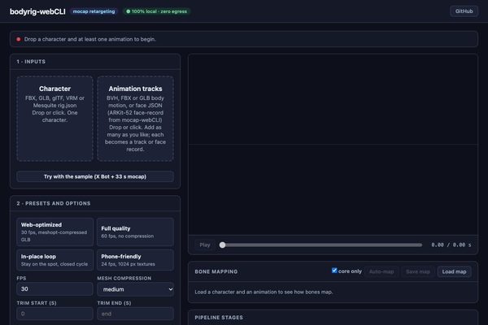
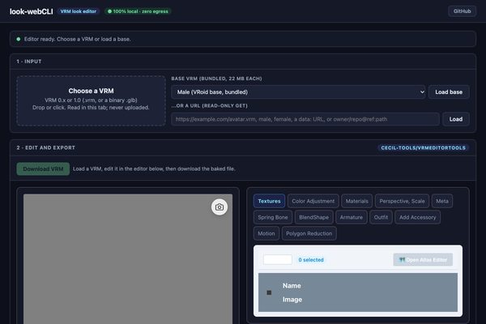
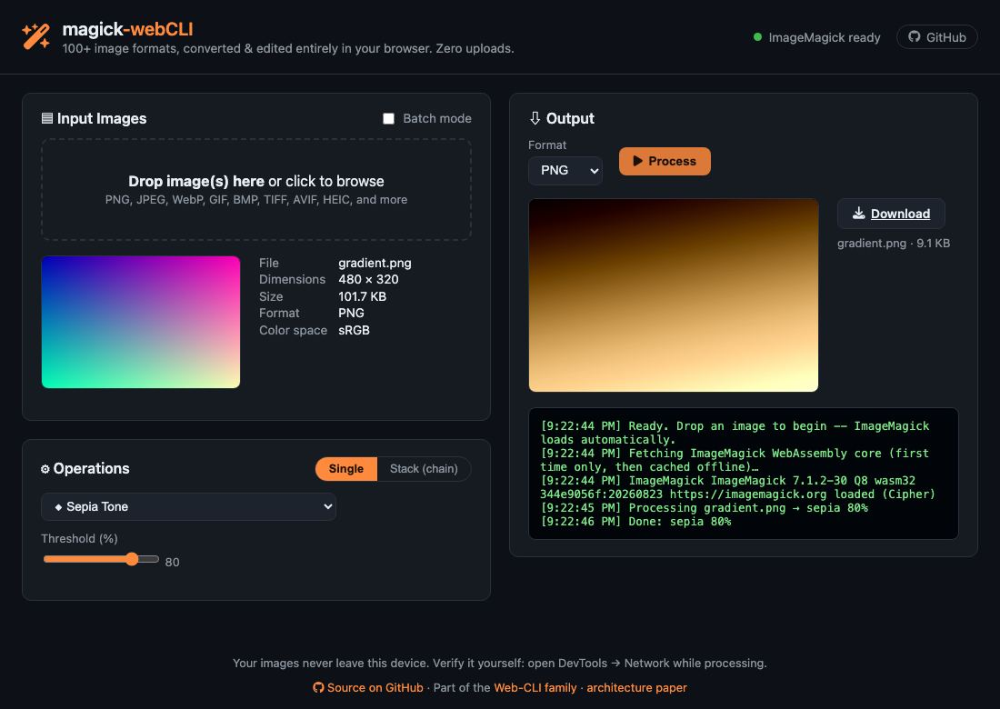

# webCLI

{.lead} A family of browser tools that take a URL or a file and return an artifact, with your content processed on your device and no account; [the paper](https://arxiv.org/abs/2608.28950) explains the architecture. Loading code and models, and publishing to a repository, are the two declared exceptions below.

This index is itself built with [blog-webCLI](https://blog.webcli.app/), from the [webcli.app repository](https://github.com/tejaswigowda/webcli.app).

drop, chess and rtc share [only-connect](https://github.com/tejaswigowda/only-connect.js#this-does-not-fix-client-isolated-networks), which does not work across client-isolated networks; no TURN server is deployed.

<div class="section-nav" aria-label="Sections"><a href="#contract">Contract</a><a href="#tools">Tools</a><a href="#example">Example</a><a href="#agents">Agents and scripts</a><a href="#privacy">Privacy</a></div>

<h2 id="contract">The contract</h2>

- **URL in, artifact out.**
- **GET-only for loading.** Input URLs, code and models are fetched with GET requests.
- **On-device processing.** Your content stays on your device unless you explicitly publish it.
- **No account to process a file.** Publishing tools require access to your repository.

Zero-egress is about your content, not about downloading the application. Each card declares what the tool fetches; hls and blog also publish to a repository when you ask them to.

### The agent surface

Implemented today by 3mf, blog, chat, chess, look, magick, portrait, rig (8 of 15 tools). The other tools do not have it yet.

- `run=` in the URL starts the operation where supported.
- `window.__webcli_result` holds the result: `{ ok, op, artifact, error, meta }`.
- `[data-webcli-status]` on the body reports `idle`, `loading`, `running`, `done` or `error`.
- Stable test ids for each tool are listed on its card.

```js
// wait for the operation to finish, then read the handle
await page.waitForSelector('body[data-webcli-status=done], body[data-webcli-status=error]');
const result = await page.evaluate(() => window.__webcli_result);
```

<h2 id="tools">Tools</h2>

{.small} 15 tools, grouped by what they transform. Every entry states its version, live URL or none, licence and measurement status.

## Video and audio

<article class="tool" id="tool-dub"><a class="thumb" href="https://tejaswigowda.com/dub-webCLI/"></a><h4><a href="https://tejaswigowda.com/dub-webCLI/">dub</a> <span class="badge no">no run= yet</span> <span class="badge yes">working</span></h4><dl><dt>version</dt><dd>1.0.0</dd><dt>live</dt><dd><a href="https://tejaswigowda.com/dub-webCLI/">https://tejaswigowda.com/dub-webCLI/</a></dd><dt>measurement</dt><dd>partially measured</dd><dt>in</dt><dd>an SRT file</dd><dt>out</dt><dd>one WAV with every cue spoken at its timestamp, and a report.json of overruns and collisions</dd><dt>not</dt><dd>whisper, which turns speech into text; this only writes speech, and never time-stretches a cue</dd><dt>egress</dt><dd>none: your content stays on the device</dd><dt>fetches</dt><dd>weights:huggingface</dd><dt>repro</dt><dd>same input, same bytes (tested)</dd></dl><p class="caveat">Byte-identical output holds on the wasm device with q8, not on webgpu. No run= surface yet.</p><p class="boundary"><strong>Boundary:</strong> No uploads, no servers, no API keys. All processing happens locally in your browser using Transformers.js and ONNX Runtime WebAssembly.</p><p class="meta"><a href="https://github.com/tejaswigowda/dub-webCLI">source</a> · GPL-3.0 · <a href="https://github.com/tejaswigowda/dub-webCLI#tests-and-gates">passing gates</a></p></article>

<article class="tool" id="tool-ffmpeg"><a class="thumb" href="https://tejaswigowda.com/ffmpeg-webCLI/"></a><h4><a href="https://tejaswigowda.com/ffmpeg-webCLI/">ffmpeg</a> <span class="badge no">no run= yet</span> <span class="badge no">early</span></h4><dl><dt>version</dt><dd>2.0.0</dd><dt>live</dt><dd><a href="https://tejaswigowda.com/ffmpeg-webCLI/">https://tejaswigowda.com/ffmpeg-webCLI/</a></dd><dt>measurement</dt><dd>partially measured</dd><dt>in</dt><dd>a video, audio or image file from your device</dd><dt>out</dt><dd>that media trimmed, converted, scaled or compressed, or as a GIF or extracted audio</dd><dt>not</dt><dd>hls, which only builds and manages adaptive-streaming libraries; this one is the general transforms</dd><dt>egress</dt><dd>none: your content stays on the device</dd><dt>fetches</dt><dd>code:cdnjs, code:jsdelivr</dd><dt>repro</dt><dd>not verified</dd></dl><p class="caveat">No gate table yet and no run= surface.</p><p class="boundary"><strong>Boundary:</strong> No uploads, no servers -- all processing happens locally in your browser using WebAssembly.</p><p class="meta"><a href="https://github.com/tejaswigowda/ffmpeg-webCLI">source</a> · GPL-3.0</p></article>

<article class="tool" id="tool-hls"><h4><a href="https://hls.webcli.app/">hls</a> <span class="badge no">no run= yet</span> <span class="badge yes">working</span></h4><dl><dt>version</dt><dd>unversioned</dd><dt>live</dt><dd><a href="https://hls.webcli.app/">https://hls.webcli.app/</a></dd><dt>measurement</dt><dd>partially measured</dd><dt>in</dt><dd>an MP4 and the git repository it should live in</dd><dt>out</dt><dd>a versioned adaptive-streaming release (ladder, segments, playlists) committed and tagged name/vN</dd><dt>not</dt><dd>ffmpeg, which does general transforms and keeps nothing; this one does exactly one thing</dd><dt>egress</dt><dd>user-initiated</dd><dt>fetches</dt><dd>not audited yet</dd><dt>repro</dt><dd>not verified</dd></dl><p class="caveat">Publishing is a commit to your repository, so it is egress, and it is yours to start. H.264 only; variable-frame-rate and rotated files are refused by name.</p><p class="boundary"><strong>Boundary:</strong> No servers, no accounts, no uploads: your video is decoded and encoded in your browser, and nothing leaves it until you press Publish.</p><p class="meta"><a href="https://github.com/tejaswigowda/hls-webCLI">source</a> · GPL-3.0 · <a href="https://github.com/tejaswigowda/hls-webCLI#tests-and-gates">passing gates</a></p></article>

<article class="tool" id="tool-video"><a class="thumb" href="https://video.webcli.app/"></a><h4><a href="https://video.webcli.app/">video</a> <span class="badge no">no run= yet</span> <span class="badge no">early</span></h4><dl><dt>version</dt><dd>0.1.0</dd><dt>live</dt><dd><a href="https://video.webcli.app/">https://video.webcli.app/</a></dd><dt>measurement</dt><dd>partially measured</dd><dt>in</dt><dd>screen, camera, microphone or existing video clips</dd><dt>out</dt><dd>an edited MP4 with mixed audio and optional burned or selectable captions</dd><dt>not</dt><dd>ffmpeg, which records and assembles an editing timeline; ffmpeg transforms media files you already have</dd><dt>egress</dt><dd>none: your content stays on the device</dd><dt>fetches</dt><dd>nothing</dd><dt>repro</dt><dd>not verified</dd><dt>testids</dt><dd>media-input, start-button, stop-button, preview, timeline-clips, export-mp4</dd></dl><p class="caveat">Capture is an explicit browser permission. Export determinism is not guaranteed across browser builds or hardware. No run= surface yet.</p><p class="boundary"><strong>Boundary:</strong> A local-first iMovie-style editor that records, trims, captions and exports video without uploading it.</p><p class="meta"><a href="https://github.com/tejaswigowda/video-webCLI">source</a> · UNLICENSED</p></article>

<article class="tool" id="tool-whisper"><a class="thumb" href="https://tejaswigowda.com/whisper-webCLI/"></a><h4><a href="https://tejaswigowda.com/whisper-webCLI/">whisper</a> <span class="badge no">no run= yet</span> <span class="badge no">early</span></h4><dl><dt>version</dt><dd>unversioned</dd><dt>live</dt><dd><a href="https://tejaswigowda.com/whisper-webCLI/">https://tejaswigowda.com/whisper-webCLI/</a></dd><dt>measurement</dt><dd>partially measured</dd><dt>in</dt><dd>an audio or video file from your device</dd><dt>out</dt><dd>a transcript as text, SRT or WebVTT</dd><dt>not</dt><dd>dub, which goes the other way, from subtitles to speech</dd><dt>egress</dt><dd>none: your content stays on the device</dd><dt>fetches</dt><dd>code:cdnjs, code:jsdelivr, weights:huggingface</dd><dt>repro</dt><dd>not verified</dd></dl><p class="caveat">No gate table yet and no run= surface. The Whisper model is downloaded on first use.</p><p class="boundary"><strong>Boundary:</strong> No uploads, no servers. All processing happens locally in your browser using Transformers.js and ONNX models.</p><p class="meta"><a href="https://github.com/tejaswigowda/whisper-webCLI">source</a> · GPL-3.0</p></article>

## 3D and motion

<article class="tool" id="tool-3mf"><a class="thumb" href="https://3mf.webcli.app/"></a><h4><a href="https://3mf.webcli.app/">3mf</a> <span class="badge yes">run= yes</span> <span class="badge no">early</span></h4><dl><dt>version</dt><dd>0.1.0</dd><dt>live</dt><dd><a href="https://3mf.webcli.app/">https://3mf.webcli.app/</a></dd><dt>measurement</dt><dd>partially measured</dd><dt>in</dt><dd>a GLB model</dd><dt>out</dt><dd>a 3MF with its materials segmented by colour, for multi-material printing</dd><dt>not</dt><dd>rig, which bakes motion into an animated GLB; this converts one model to one print format and animates nothing</dd><dt>egress</dt><dd>none: your content stays on the device</dd><dt>fetches</dt><dd>code:cdnjs, code:jsdelivr, input-urls:user-named</dd><dt>repro</dt><dd>not verified</dd><dt>params</dt><dd><code>src=</code> <code>run=convert</code> <code>[materials=2|3|4|5|6|7|8]</code> <code>[download=1]</code></dd><dt>result</dt><dd><code>window.__webcli_result = { ok, op: &#39;convert&#39;, artifact: { mime, name, size, dataUrl } | null, error: string | null, meta: { tool, materials } }</code></dd></dl><p class="caveat">GLB input only. URL runs export 3MF; the interactive editor can also export segmented GLB. No gate table yet.</p><p class="boundary"><strong>Boundary:</strong> No uploads, no servers - all processing happens locally in your browser.</p><p class="meta"><a href="https://github.com/tejaswigowda/3mf-webCLI">source</a> · GPL-3.0</p></article>

<article class="tool" id="tool-rig"><a class="thumb" href="https://rig.webcli.app/"></a><h4><a href="https://rig.webcli.app/">rig</a> <span class="badge yes">run= yes</span> <span class="badge no">early</span></h4><dl><dt>version</dt><dd>0.1.0</dd><dt>live</dt><dd><a href="https://rig.webcli.app/">https://rig.webcli.app/</a></dd><dt>measurement</dt><dd>partially measured</dd><dt>in</dt><dd>a skinned character (FBX, GLB or VRM) and motion files (BVH, FBX or GLB)</dd><dt>out</dt><dd>one optimized animated GLB carrying each motion as its own track</dd><dt>not</dt><dd>mocap, which records motion from a camera; this one watches nothing and retargets motion that already exists</dd><dt>egress</dt><dd>none: your content stays on the device</dd><dt>fetches</dt><dd>input-urls:user-named; if enabled: code:esm-run, weights:huggingface</dd><dt>repro</dt><dd>same input, same bytes (tested)</dd><dt>params</dt><dd><code>character=</code> <code>motion= (repeatable)</code> <code>[map=]</code> <code>[args=]</code> <code>[run=bake]</code></dd><dt>result</dt><dd><code>window.__webcli_result = { ok, op: &#39;bake&#39;, artifact: { mime, name, size, dataUrl } | null, error: string | null, meta: { tracks, frames, fps, mapped, bones, units, blendshapes } }</code></dd><dt>testids</dt><dd>character-input, motion-input, bake, command, run, result, download</dd></dl><p class="caveat">The optional in-page assist is off by default; turning it on downloads about 1 GB of model weights. Its tests are not yet published as a gate table.</p><p class="boundary"><strong>Boundary:</strong> No uploads, no servers: everything happens in your browser.</p><p class="meta"><a href="https://github.com/tejaswigowda/rig-webCLI">source</a> · GPL-3.0</p></article>

## Images

<article class="tool" id="tool-look"><a class="thumb" href="https://look.webcli.app/"></a><h4><a href="https://look.webcli.app/">look</a> <span class="badge yes">run= yes</span> <span class="badge no">early</span></h4><dl><dt>version</dt><dd>0.1.0</dd><dt>live</dt><dd><a href="https://look.webcli.app/">https://look.webcli.app/</a></dd><dt>measurement</dt><dd>partially measured</dd><dt>in</dt><dd>a VRM avatar</dd><dt>out</dt><dd>the same avatar, as a VRM, with its textures, materials, outfits or accessories changed</dd><dt>not</dt><dd>portrait, which reads a face from a photo and binds it to a VRM; this one never sees a photo</dd><dt>egress</dt><dd>none: your content stays on the device</dd><dt>fetches</dt><dd>input-urls:user-named</dd><dt>repro</dt><dd>not verified</dd><dt>params</dt><dd><code>vrm=</code> <code>[run=export]</code></dd><dt>result</dt><dd><code>window.__webcli_result = { ok, op: &#39;export&#39;, artifact: { mime, name, size, dataUrl } | null, error: string | null, meta: { source, bytesIn, bytesOut, vrmVersion } }</code></dd><dt>testids</dt><dd>vrm-input, vrm-url, load, sample, download, result</dd></dl><p class="caveat">The editor re-exports through its own writer, so the output is not a byte-audited edit of the input. Determinism is measured on the two bundled bases only.</p><p class="boundary"><strong>Boundary:</strong> It is not an installable offline PWA.</p><p class="meta"><a href="https://github.com/tejaswigowda/look-webCLI">source</a> · GPL-3.0</p></article>

<article class="tool" id="tool-magick"><a class="thumb" href="https://magick.webcli.app/"></a><h4><a href="https://magick.webcli.app/">magick</a> <span class="badge yes">run= yes</span> <span class="badge no">early</span></h4><dl><dt>version</dt><dd>unversioned</dd><dt>live</dt><dd><a href="https://magick.webcli.app/">https://magick.webcli.app/</a></dd><dt>measurement</dt><dd>partially measured</dd><dt>in</dt><dd>image files from your device</dd><dt>out</dt><dd>those images converted between 100+ formats, or edited with chained, batchable operations</dd><dt>not</dt><dd>look, which edits the textures and materials of a VRM avatar; this one edits pictures and knows nothing of avatars</dd><dt>egress</dt><dd>none: your content stays on the device</dd><dt>fetches</dt><dd>code:cdnjs, code:jsdelivr</dd><dt>repro</dt><dd>not verified</dd><dt>params</dt><dd><code>src= (repeatable)</code> <code>run=convert|resize|crop|rotate|grayscale|sepia|blur|sharpen|watermark|montage|compare</code> <code>[params=]</code> <code>[format=PNG|JPEG|WEBP|GIF|BMP|TIFF|AVIF]</code> <code>[quality=]</code> <code>[download=1]</code></dd><dt>result</dt><dd><code>undefined = undefined</code></dd><dt>testids</dt><dd>dropzone, batchToggle, opSelect, processBtn, downloadLink, result, resultEmpty, log</dd></dl><p class="caveat">No gate table yet.</p><p class="boundary"><strong>Boundary:</strong> No uploads, no servers, all processing happens locally in your browser.</p><p class="meta"><a href="https://github.com/tejaswigowda/magick-webCLI">source</a> · Apache-2.0</p></article>

<article class="tool" id="tool-portrait"><a class="thumb" href="https://portrait.webcli.app/"></a><h4><a href="https://portrait.webcli.app/">portrait</a> <span class="badge yes">run= yes</span> <span class="badge no">early</span></h4><dl><dt>version</dt><dd>0.1.0</dd><dt>live</dt><dd><a href="https://portrait.webcli.app/">https://portrait.webcli.app/</a></dd><dt>measurement</dt><dd>partially measured</dd><dt>in</dt><dd>a photo of one face and a base VRM</dd><dt>out</dt><dd>that VRM with its expressions bound to the face read from the photo</dd><dt>not</dt><dd>look, which edits an avatar&#39;s textures and outfits by hand; this one reads a face, and its result is not a likeness</dd><dt>egress</dt><dd>none: your content stays on the device</dd><dt>fetches</dt><dd>input-urls:user-named</dd><dt>repro</dt><dd>not verified</dd><dt>params</dt><dd><code>[vrm=male|female|&lt;url&gt;]</code> <code>[run=bind]</code> <code>[download=1]</code></dd><dt>result</dt><dd><code>window.__webcli_result = { ok, op: &#39;bind&#39;, artifact: { mime, name, size, dataUrl } | null, error: string | null, meta }</code></dd><dt>testids</dt><dd>bind, download, face-input, photo-input, result, status, vrm-input, vrm-url</dd></dl><p class="caveat">Approximate, not a likeness. One clear front-facing face. The photo is read from a local file only, so a run needs a person or a runner with the file.</p><p class="boundary"><strong>Boundary:</strong> Approximate, not a likeness.</p><p class="meta"><a href="https://github.com/tejaswigowda/portrait-webCLI">source</a> · GPL-3.0</p></article>

## Text and publishing

<article class="tool" id="tool-blog"><h4><a href="https://blog.webcli.app/">blog</a> <span class="badge yes">run= yes</span> <span class="badge no">early</span></h4><dl><dt>version</dt><dd>0.5.1</dd><dt>live</dt><dd><a href="https://blog.webcli.app/">https://blog.webcli.app/</a></dd><dt>measurement</dt><dd>partially measured</dd><dt>in</dt><dd>Markdown pages and optional posts in a GitHub repository</dd><dt>out</dt><dd>a static website committed back to that repository, with a feed when it has posts</dd><dt>not</dt><dd>hls, which makes the video releases a post can embed; this one encodes no video</dd><dt>egress</dt><dd>user-initiated</dd><dt>fetches</dt><dd>not audited yet</dd><dt>repro</dt><dd>not verified</dd><dt>params</dt><dd><code>[markdown=]</code> <code>[src=]</code> <code>run=render</code> <code>[format=HTML]</code> <code>[download=1]</code></dd><dt>result</dt><dd><code>undefined = undefined</code></dd><dt>testids</dt><dd>run, download, result, status</dd></dl><p class="caveat">Publishing is a commit to your repository, so it is egress, and it is yours to start. Its own test suite had 5 failures of 598 on 2026-11-15. Every page it generates loads Font Awesome from cdnjs, with no way to turn that off.</p><p class="boundary"><strong>Boundary:</strong> No application server or per-site deployment is required.</p><p class="meta"><a href="https://github.com/tejaswigowda/blog-webCLI">source</a> · GPL-3.0 (tool), MIT (runtime)</p></article>

<article class="tool" id="tool-chat"><a class="thumb" href="https://chat.webcli.app/"></a><h4><a href="https://chat.webcli.app/">chat</a> <span class="badge yes">run= yes</span> <span class="badge no">early</span></h4><dl><dt>version</dt><dd>unversioned</dd><dt>live</dt><dd><a href="https://chat.webcli.app/">https://chat.webcli.app/</a></dd><dt>measurement</dt><dd>partially measured</dd><dt>in</dt><dd>text you type</dd><dt>out</dt><dd>a reply from a language model running on your own GPU</dd><dt>not</dt><dd>blog, which writes to a repository and publishes; this one keeps conversations in this browser and sends them nowhere</dd><dt>egress</dt><dd>none: your content stays on the device</dd><dt>fetches</dt><dd>code:cdnjs, code:jsdelivr, code:esm-run, code:github-raw, weights:huggingface</dd><dt>repro</dt><dd>not verified</dd><dt>params</dt><dd><code>prompt=</code> <code>run=chat</code> <code>[model=]</code> <code>[temperature=]</code></dd><dt>result</dt><dd><code>undefined = undefined</code></dd><dt>testids</dt><dd>model-select, load-btn, send-btn, user-input, chat-window, status-text, result</dd></dl><p class="caveat">Needs WebGPU. Model weights are downloaded on first use. Conversations are saved in this browser&#39;s localStorage. No gate table yet.</p><p class="boundary"><strong>Boundary:</strong> A browser-based LLM chat app that runs large language models entirely in your browser using WebLLM and WebGPU - no server, no API keys, no data leaves your device.</p><p class="meta"><a href="https://github.com/tejaswigowda/chat-webCLI">source</a> · GPL-3.0</p></article>

## File transfer

<article class="tool" id="tool-drop"><h4><a href="https://drop.webcli.app/">drop</a> <span class="badge no">no run= yet</span> <span class="badge no">early</span></h4><dl><dt>version</dt><dd>0.2.8</dd><dt>live</dt><dd><a href="https://drop.webcli.app/">https://drop.webcli.app/</a></dd><dt>measurement</dt><dd>partially measured</dd><dt>in</dt><dd>one or more files or folders from your device</dd><dt>out</dt><dd>verified files exchanged with the people in a temporary room</dd><dt>not</dt><dd>box, which stores content for later; drop keeps both browsers present and transfers directly</dd><dt>egress</dt><dd>user-initiated peer transfer</dd><dt>fetches</dt><dd>signaling:public-nostr-relays, stun:stun.cloudflare.com</dd><dt>repro</dt><dd>not verified</dd></dl><p class="caveat">v0.2.8 is functional for current desktop testing. Browser-size ceilings, throughput and the wider device matrix are pending.</p><p class="boundary"><strong>Boundary:</strong> This is not storage, a cloud locker, a mailbox, or “AirDrop for the internet.” Both browsers must be open at the same time. There is no nearby discovery.</p><p class="meta"><a href="https://github.com/tejaswigowda/drop-webCLI">source</a> · GPL-3.0-only</p></article>

## Games

<article class="tool" id="tool-chess"><h4><a href="https://chess.webcli.app/">chess</a> <span class="badge yes">run= yes</span> <span class="badge no">early</span></h4><dl><dt>version</dt><dd>0.2.0</dd><dt>live</dt><dd><a href="https://chess.webcli.app/">https://chess.webcli.app/</a></dd><dt>measurement</dt><dd>partially measured</dd><dt>in</dt><dd>an invite link, or nothing for a game on this device</dd><dt>out</dt><dd>a game, with a PGN saved on this device if you choose</dd><dt>not</dt><dd>rtc, which makes live calls; chess exchanges signed moves and can keep a game in a git repository</dd><dt>egress</dt><dd>rooms: peers, relays and STUN; git-backed games: user-initiated GitHub commits</dd><dt>fetches</dt><dd>relays:public-nostr, stun:stun.cloudflare.com, weights:huggingface, api:github</dd><dt>repro</dt><dd>same input, same bytes (tested)</dd><dt>params</dt><dd><code>run=analyze</code> <code>[pgn=]</code> <code>[fen=]</code> <code>[format=PGN|FEN]</code> <code>[download=1]</code></dd><dt>result</dt><dd><code>undefined = undefined</code></dd><dt>testids</dt><dd>board, status, movesOut, btnPgn, btnFen, btnDownload</dd></dl><p class="caveat">v0.2.0 (protocol 1). One network test passed; the wider real-device/network matrix, the real GitHub API path and the optional model on a real GPU remain unverified.</p><p class="boundary"><strong>Boundary:</strong> On-device games are zero-egress. Rooms cannot be, because moves have to reach the other player; every request is declared and checkable in DevTools instead.</p><p class="meta"><a href="https://github.com/tejaswigowda/chess-webCLI">source</a> · GPL-3.0-only</p></article>

## Calls

<article class="tool" id="tool-rtc"><h4><a href="https://tejaswigowda.com/rtc-webCLI/">rtc</a> <span class="badge no">no run= yet</span> <span class="badge no">early</span></h4><dl><dt>version</dt><dd>0.3.0</dd><dt>live</dt><dd><a href="https://tejaswigowda.com/rtc-webCLI/">https://tejaswigowda.com/rtc-webCLI/</a></dd><dt>measurement</dt><dd>partially measured</dd><dt>in</dt><dd>an invite link, plus camera, microphone or screen when you choose to share them</dd><dt>out</dt><dd>a live peer-to-peer call; no file or artifact</dd><dt>not</dt><dd>chess, which exchanges signed game moves and offers; rtc sends live media between participants</dd><dt>egress</dt><dd>user-initiated media to peers; signaling through relays and STUN</dd><dt>fetches</dt><dd>relays:public-nostr, stun:stun.cloudflare.com</dd><dt>repro</dt><dd>not verified</dd></dl><p class="caveat">v0.3.0 (protocol 3) has not yet been run on real devices. The latest recorded device run was on v0.2.0: two runs passed and one failed on one home Wi-Fi network.</p><p class="boundary"><strong>Boundary:</strong> A call has to send. Your media goes to the other people in the room, and the introduction relays and a STUN server are contacted to set that up.</p><p class="meta"><a href="https://github.com/tejaswigowda/rtc-webCLI">source</a> · GPL-3.0-only</p></article>

## Libraries (not tools)

<article class="library" id="library-3DOM"><h4>3DOM</h4><p>A library for addressing and editing three.js scenes with CSS-like selectors, deterministic auto-labelling and undoable operations. It has no standalone tool UI or command surface.</p><dl><dt>kind</dt><dd>library (no UI or command surface)</dd><dt>version</dt><dd>1.0.0</dd><dt>live</dt><dd>none</dd><dt>licence</dt><dd>MIT</dd><dt>measurement</dt><dd>pending</dd></dl><p class="boundary"><strong>Boundary:</strong> No editor. No framework. No build step required. Just three.js (a peer dependency) and this.</p><p class="meta"><a href="https://github.com/tejaswigowda/3dom">source</a></p></article>

<article class="library" id="library-only-connect"><h4>only-connect</h4><p>Shared browser-to-browser room transport used by drop, chess and rtc. Library only: it has no UI or command surface.</p><dl><dt>kind</dt><dd>library (no UI or command surface)</dd><dt>version</dt><dd>0.1.0</dd><dt>live</dt><dd>none</dd><dt>licence</dt><dd>GPL-3.0-only</dd><dt>measurement</dt><dd>partially measured</dd></dl><p class="boundary"><strong>Boundary:</strong> Guest Wi-Fi, classroom and institutional networks that isolate clients will still defeat a direct WebRTC connection. only-connect is the vehicle, not the cure.</p><p class="meta"><a href="https://github.com/tejaswigowda/only-connect.js">source</a></p></article>

<h2 id="example">A worked example</h2>

ImageMagick in a tab: sepia on a 480 by 320 PNG, nothing uploaded

<figure><figcaption>magick-webCLI after a sepia run: the input gradient on the left, the sepia-toned output on the right, and the log line &#39;Done: sepia 80%&#39;.</figcaption></figure>

14 requests during page load and the run: 9 to magick.webcli.app, 3 to cdnjs.cloudflare.com (icon font), 2 to cdn.jsdelivr.net (ImageMagick WebAssembly). All were GETs and none carried a body, so the image was in no request.

{.small} Historical measurement, verified 2026-10-20, Chromium, magick.webcli.app; not a new audit of the current application. Open DevTools, Network, then drop an image and press Process. magick now exposes URL runs for conversion and operations; the worked example remains the interactive measurement.
