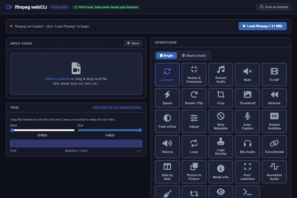
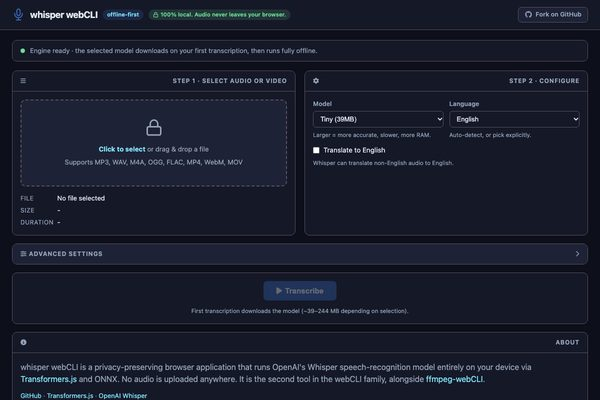
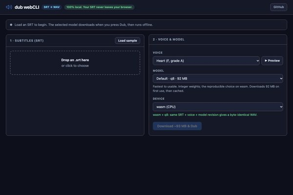
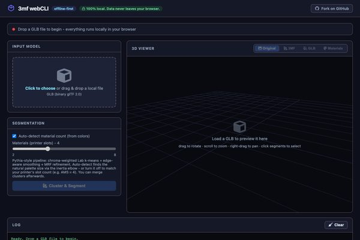
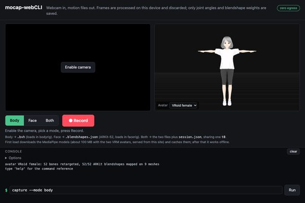
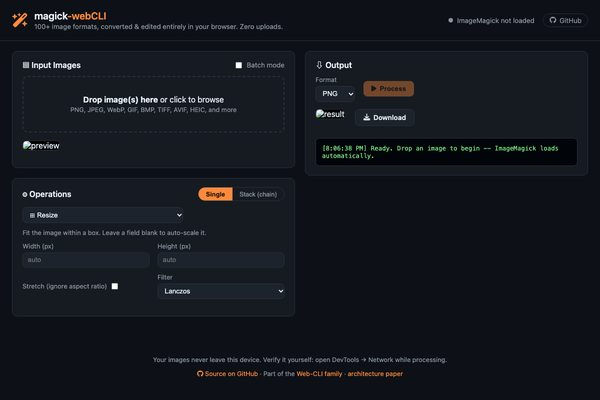
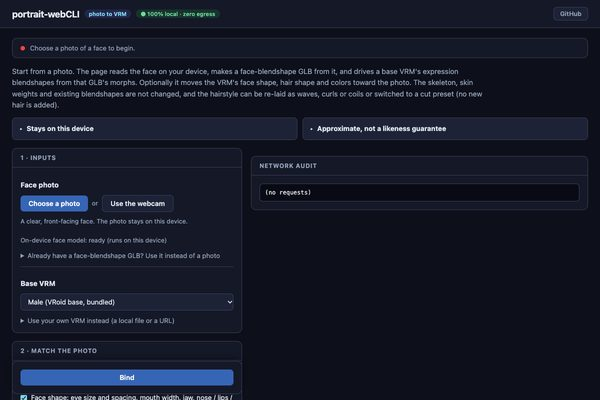
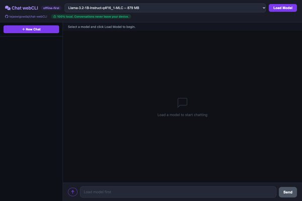

# webCLI

{.lead} A family of browser tools that take a URL or a file and return an artifact, with your content processed on your device and no account; [the paper](https://arxiv.org/abs/2608.28950) explains the architecture. Loading code and models, and publishing to a repository, are the two declared exceptions below.

<div class="section-nav" aria-label="Sections"><a href="#contract">Contract</a><a href="#tools">Tools</a><a href="#example">Example</a><a href="#agents">Agents and scripts</a><a href="#privacy">Privacy</a></div>

<h2 id="contract">The contract</h2>

- **URL in, artifact out.**
- **GET-only for loading.** Input URLs, code and models are fetched with GET requests.
- **On-device processing.** Your content stays on your device unless you explicitly publish it.
- **No account to process a file.** Publishing tools require access to your repository.

Zero-egress is about your content, not about downloading the application. Each card declares what the tool fetches; hls and blog also publish to a repository when you ask them to.

### The agent surface

Implemented today by rig, look, portrait (3 of 12 tools). The other tools do not have it yet.

- `run=` in the URL starts the operation where supported.
- `window.__webcli_result` holds the result: `{ ok, op, artifact, error, meta }`.
- `[data-webcli-status]` on the body reports `idle`, `loading`, `running`, `done` or `error`.
- Stable test ids for each tool are listed on its card.

```js
// wait for the operation to finish, then read the handle
await page.waitForSelector('body[data-webcli-status=done], body[data-webcli-status=error]');
const result = await page.evaluate(() => window.__webcli_result);
```

<h2 id="tools">Tools</h2>

{.small} 12 tools, grouped by what they transform. In params, brackets mark optional values. A state of early names its limits; working links passing gates.

## Video and audio

<article class="tool" id="tool-ffmpeg"><a class="thumb" href="https://ffmpeg.webcli.app/"></a><h4><a href="https://ffmpeg.webcli.app/">ffmpeg</a> <span class="badge no">no run= yet</span> <span class="badge no">early</span></h4><dl><dt>in</dt><dd>a video, audio or image file from your device</dd><dt>out</dt><dd>that media trimmed, converted, scaled or compressed, or as a GIF or extracted audio</dd><dt>not</dt><dd>hls, which only builds and manages adaptive-streaming libraries; this one is the general transforms</dd><dt>egress</dt><dd>none: your content stays on the device</dd><dt>fetches</dt><dd>code:cdnjs, code:jsdelivr</dd><dt>repro</dt><dd>not verified</dd></dl><p class="caveat">No gate table yet and no run= surface.</p><p class="meta"><a href="https://github.com/tejaswigowda/ffmpeg-webCLI">source</a> · GPL-3.0</p></article>

<article class="tool" id="tool-hls"><h4><a href="https://hls.webcli.app/">hls</a> <span class="badge no">no run= yet</span> <span class="badge yes">working</span></h4><dl><dt>in</dt><dd>an MP4 and the git repository it should live in</dd><dt>out</dt><dd>a versioned adaptive-streaming release (ladder, segments, playlists) committed and tagged name/vN</dd><dt>not</dt><dd>ffmpeg, which does general transforms and keeps nothing; this one does exactly one thing</dd><dt>egress</dt><dd>user-initiated</dd><dt>fetches</dt><dd>not audited yet</dd><dt>repro</dt><dd>not verified</dd></dl><p class="caveat">Publishing is a commit to your repository, so it is egress, and it is yours to start. H.264 only; variable-frame-rate and rotated files are refused by name.</p><p class="meta"><a href="https://github.com/tejaswigowda/hls-webCLI">source</a> · GPL-3.0 · <a href="https://github.com/tejaswigowda/hls-webCLI#tests-and-gates">passing gates</a></p></article>

<article class="tool" id="tool-whisper"><a class="thumb" href="https://whisper.webcli.app/"></a><h4><a href="https://whisper.webcli.app/">whisper</a> <span class="badge no">no run= yet</span> <span class="badge no">early</span></h4><dl><dt>in</dt><dd>an audio or video file from your device</dd><dt>out</dt><dd>a transcript as text, SRT or WebVTT</dd><dt>not</dt><dd>dub, which goes the other way, from subtitles to speech</dd><dt>egress</dt><dd>none: your content stays on the device</dd><dt>fetches</dt><dd>code:cdnjs, code:jsdelivr, weights:huggingface</dd><dt>repro</dt><dd>not verified</dd></dl><p class="caveat">No gate table yet and no run= surface. The Whisper model is downloaded on first use.</p><p class="meta"><a href="https://github.com/tejaswigowda/whisper-webCLI">source</a> · GPL-3.0</p></article>

<article class="tool" id="tool-dub"><a class="thumb" href="https://dub.webcli.app/"></a><h4><a href="https://dub.webcli.app/">dub</a> <span class="badge no">no run= yet</span> <span class="badge yes">working</span></h4><dl><dt>in</dt><dd>an SRT file</dd><dt>out</dt><dd>one WAV with every cue spoken at its timestamp, and a report.json of overruns and collisions</dd><dt>not</dt><dd>whisper, which turns speech into text; this only writes speech, and never time-stretches a cue</dd><dt>egress</dt><dd>none: your content stays on the device</dd><dt>fetches</dt><dd>weights:huggingface</dd><dt>repro</dt><dd>same input, same bytes (tested)</dd></dl><p class="caveat">Byte-identical output holds on the wasm device with q8, not on webgpu. No run= surface yet.</p><p class="meta"><a href="https://github.com/tejaswigowda/dub-webCLI">source</a> · GPL-3.0 · <a href="https://github.com/tejaswigowda/dub-webCLI#tests-and-gates">passing gates</a></p></article>

## 3D and motion

<article class="tool" id="tool-3mf"><a class="thumb" href="https://3mf.webcli.app/"></a><h4><a href="https://3mf.webcli.app/">3mf</a> <span class="badge no">no run= yet</span> <span class="badge no">early</span></h4><dl><dt>in</dt><dd>a GLB model</dd><dt>out</dt><dd>a 3MF with its materials segmented by colour, for multi-material printing</dd><dt>not</dt><dd>rig, which bakes motion into an animated GLB; this converts one model to one print format and animates nothing</dd><dt>egress</dt><dd>none: your content stays on the device</dd><dt>fetches</dt><dd>code:cdnjs, code:jsdelivr</dd><dt>repro</dt><dd>not verified</dd></dl><p class="caveat">GLB in, 3MF out, nothing else. No gate table yet and no run= surface.</p><p class="meta"><a href="https://github.com/tejaswigowda/3mf-webCLI">source</a> · GPL-3.0</p></article>

<article class="tool" id="tool-mocap"><a class="thumb" href="https://mocap.webcli.app/"></a><h4><a href="https://mocap.webcli.app/">mocap</a> <span class="badge no">no run= yet</span> <span class="badge no">early</span></h4><dl><dt>in</dt><dd>a webcam or a video file of a person</dd><dt>out</dt><dd>body motion as a BVH and face motion as ARKit blendshapes JSON</dd><dt>not</dt><dd>rig, which retargets motion onto a character you bring; this one only records, and bakes only onto its two bundled avatars</dd><dt>egress</dt><dd>none: your content stays on the device</dd><dt>fetches</dt><dd>nothing</dd><dt>repro</dt><dd>not verified</dd></dl><p class="caveat">The source repository is private, so there is no open licence yet. One webcam cannot give studio-grade face and body at once. First load is about 100 MB.</p><p class="meta">source: private · unpublished</p></article>

<article class="tool" id="tool-rig"><a class="thumb" href="https://rig.webcli.app/"></a><h4><a href="https://rig.webcli.app/">rig</a> <span class="badge yes">run= yes</span> <span class="badge no">early</span></h4><dl><dt>in</dt><dd>a skinned character (FBX, GLB or VRM) and motion files (BVH, FBX or GLB)</dd><dt>out</dt><dd>one optimized animated GLB carrying each motion as its own track</dd><dt>not</dt><dd>mocap, which records motion from a camera; this one watches nothing and retargets motion that already exists</dd><dt>egress</dt><dd>none: your content stays on the device</dd><dt>fetches</dt><dd>input-urls:user-named; if enabled: code:esm-run, weights:huggingface</dd><dt>repro</dt><dd>same input, same bytes (tested)</dd><dt>params</dt><dd><code>character=</code> <code>motion= (repeatable)</code> <code>[map=]</code> <code>[args=]</code> <code>[run=bake]</code></dd><dt>result</dt><dd><code>window.__webcli_result = { ok, op: &#39;bake&#39;, artifact: { mime, name, size, dataUrl } | null, error: string | null, meta: { tracks, frames, fps, mapped, bones, units, blendshapes } }</code></dd><dt>testids</dt><dd>character-input, motion-input, bake, command, run, result, download</dd></dl><p class="caveat">The optional in-page assist is off by default; turning it on downloads about 1 GB of model weights. Its tests are not yet published as a gate table.</p><p class="meta"><a href="https://github.com/tejaswigowda/rig-webCLI">source</a> · GPL-3.0</p></article>

## Images

<article class="tool" id="tool-magick"><a class="thumb" href="https://magick.webcli.app/"></a><h4><a href="https://magick.webcli.app/">magick</a> <span class="badge no">no run= yet</span> <span class="badge no">early</span></h4><dl><dt>in</dt><dd>image files from your device</dd><dt>out</dt><dd>those images converted between 100+ formats, or edited with chained, batchable operations</dd><dt>not</dt><dd>look, which edits the textures and materials of a VRM avatar; this one edits pictures and knows nothing of avatars</dd><dt>egress</dt><dd>none: your content stays on the device</dd><dt>fetches</dt><dd>code:cdnjs, code:jsdelivr</dd><dt>repro</dt><dd>not verified</dd></dl><p class="caveat">No gate table yet and no run= surface.</p><p class="meta"><a href="https://github.com/tejaswigowda/magick-webCLI">source</a> · Apache-2.0</p></article>

<article class="tool" id="tool-look"><a class="thumb" href="https://look.webcli.app/"></a><h4><a href="https://look.webcli.app/">look</a> <span class="badge yes">run= yes</span> <span class="badge no">early</span></h4><dl><dt>in</dt><dd>a VRM avatar</dd><dt>out</dt><dd>the same avatar, as a VRM, with its textures, materials, outfits or accessories changed</dd><dt>not</dt><dd>portrait, which reads a face from a photo and binds it to a VRM; this one never sees a photo</dd><dt>egress</dt><dd>none: your content stays on the device</dd><dt>fetches</dt><dd>input-urls:user-named</dd><dt>repro</dt><dd>not verified</dd><dt>params</dt><dd><code>vrm=</code> <code>[run=export]</code></dd><dt>result</dt><dd><code>window.__webcli_result = { ok, op: &#39;export&#39;, artifact: { mime, name, size, dataUrl } | null, error: string | null, meta: { source, bytesIn, bytesOut, vrmVersion } }</code></dd><dt>testids</dt><dd>vrm-input, vrm-url, load, sample, download, result</dd></dl><p class="caveat">The editor re-exports through its own writer, so the output is not a byte-audited edit of the input. Determinism is measured on the two bundled bases only.</p><p class="meta"><a href="https://github.com/tejaswigowda/look-webCLI">source</a> · GPL-3.0</p></article>

<article class="tool" id="tool-portrait"><a class="thumb" href="https://portrait.webcli.app/"></a><h4><a href="https://portrait.webcli.app/">portrait</a> <span class="badge yes">run= yes</span> <span class="badge no">early</span></h4><dl><dt>in</dt><dd>a photo of one face and a base VRM</dd><dt>out</dt><dd>that VRM with its expressions bound to the face read from the photo</dd><dt>not</dt><dd>look, which edits an avatar&#39;s textures and outfits by hand; this one reads a face, and its result is not a likeness</dd><dt>egress</dt><dd>none: your content stays on the device</dd><dt>fetches</dt><dd>input-urls:user-named</dd><dt>repro</dt><dd>not verified</dd><dt>params</dt><dd><code>[vrm=male|female|&lt;url&gt;]</code> <code>[run=bind]</code> <code>[download=1]</code></dd><dt>result</dt><dd><code>window.__webcli_result = { ok, op: &#39;bind&#39;, artifact: { mime, name, size, dataUrl } | null, error: string | null, meta }</code></dd><dt>testids</dt><dd>bind, download, face-input, photo-input, result, status, vrm-input, vrm-url</dd></dl><p class="caveat">Approximate, not a likeness. One clear front-facing face. The photo is read from a local file only, so a run needs a person or a runner with the file.</p><p class="meta"><a href="https://github.com/tejaswigowda/portrait-webCLI">source</a> · GPL-3.0</p></article>

## Text and publishing

<article class="tool" id="tool-blog"><h4><a href="https://blog.webcli.app/">blog</a> <span class="badge no">no run= yet</span> <span class="badge no">early</span></h4><dl><dt>in</dt><dd>markdown posts in a GitHub repository</dd><dt>out</dt><dd>static HTML pages, a feed and a sitemap committed back to that repository</dd><dt>not</dt><dd>hls, which makes the video releases a post can embed; this one encodes no video</dd><dt>egress</dt><dd>user-initiated</dd><dt>fetches</dt><dd>not audited yet</dd><dt>repro</dt><dd>not verified</dd></dl><p class="caveat">Publishing is a commit to your repository, so it is egress, and it is yours to start. Its own test suite had 5 failures of 598 on 2026-11-15. Every page it generates loads Font Awesome from cdnjs, with no way to turn that off.</p><p class="meta"><a href="https://github.com/tejaswigowda/blog-webCLI">source</a> · GPL-3.0 (tool), MIT (runtime)</p></article>

<article class="tool" id="tool-chat"><a class="thumb" href="https://chat.webcli.app/"></a><h4><a href="https://chat.webcli.app/">chat</a> <span class="badge no">no run= yet</span> <span class="badge no">early</span></h4><dl><dt>in</dt><dd>text you type</dd><dt>out</dt><dd>a reply from a language model running on your own GPU</dd><dt>not</dt><dd>blog, which writes to a repository and publishes; this one keeps conversations in this browser and sends them nowhere</dd><dt>egress</dt><dd>none: your content stays on the device</dd><dt>fetches</dt><dd>code:cdnjs, code:jsdelivr, code:esm-run, code:github-raw, weights:huggingface</dd><dt>repro</dt><dd>not verified</dd></dl><p class="caveat">Needs WebGPU. Model weights are downloaded on first use. Conversations are saved in this browser&#39;s localStorage. No gate table yet.</p><p class="meta"><a href="https://github.com/tejaswigowda/chat-webCLI">source</a> · GPL-3.0</p></article>

<h2 id="example">A worked example</h2>

ImageMagick in a tab: sepia on a 480 by 320 PNG, nothing uploaded

<figure><figcaption>magick-webCLI after a sepia run: the input gradient on the left, the sepia-toned output on the right, and the log line &#39;Done: sepia 80%&#39;.</figcaption></figure>

14 requests during page load and the run: 9 to magick.webcli.app, 3 to cdnjs.cloudflare.com (icon font), 2 to cdn.jsdelivr.net (ImageMagick WebAssembly). All were GETs and none carried a body, so the image was in no request.

{.small} Historical measurement, verified 2026-10-20, Chromium, magick.webcli.app; not a new audit of the current application. Open DevTools, Network, then drop an image and press Process. magick has no run= surface yet, so this is the interactive path; the cards say which tools can be driven from a URL today.
